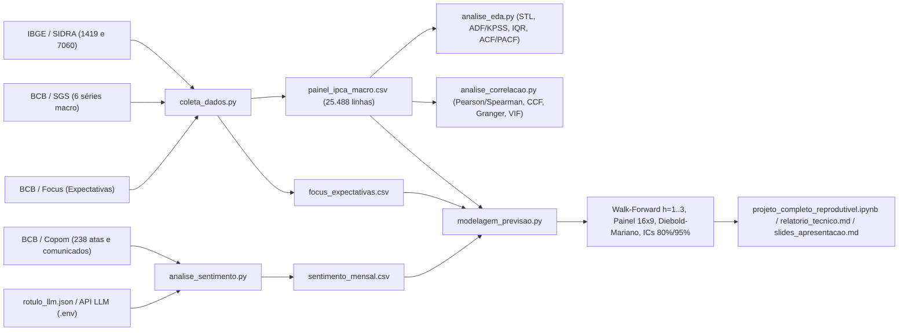

# Documentação Técnica do Projeto — Inflação e Comunicação do Copom

Esta documentação descreve a arquitetura, o fluxo de dados, os módulos Python, o catálogo completo de artefatos em `dados/tratados/` e `figuras/`, e o guia de reprodução pelos notebooks e scripts.

---

## 1. Arquitetura e Fluxo de Dados



---

## 2. Estrutura de Diretórios

```text
previsoes-Inflacao-comunicação-copom/
├── AGENTS.md                         # Diretrizes operacionais e invariantes para agentes de IA
├── DOCUMENTACAO.md                   # Documentação técnica detalhada do projeto
├── README.md                         # Visão geral e instruções rápidas de execução
├── projeto.md                        # Especificação e requisitos obrigatórios das 7 etapas
├── relatorio_tecnico.md              # Relatório técnico curto (metodologia, resultados, limitações)
├── slides_apresentacao.md            # Apresentação em slides (formato Marp)
├── requirements.txt                  # Dependências Python do ambiente .venv
├── .env                              # Chaves/configuração do LLM (ignorado pelo Git)
├── src/                              # Pipeline modular em Python
│   ├── coleta_dados.py
│   ├── analise_eda.py
│   ├── analise_correlacao.py
│   ├── analise_sentimento.py
│   └── modelagem_previsao.py
├── notebooks/                        # Notebooks executáveis e reprodutíveis
│   ├── projeto_completo_reprodutivel.ipynb
│   └── analise_exploratoria.ipynb
├── dados/tratados/                   # Bases consolidadas, dicionários e tabelas de resultados
└── figuras/                          # Gráficos gerados pelos scripts de análise e modelagem
```

---

## 3. Referência dos Módulos Python (`src/`) e Comandos CLI

Todos os scripts devem ser executados a partir da raiz do repositório utilizando o interpretador `.venv\Scripts\python.exe`.

### 3.1 `src/coleta_dados.py` (`coletar_base`)
- **Fontes consultadas:**
  - **IBGE/SIDRA:** tabelas `1419` (2012–2019) e `7060` (2020 em diante), variável `63` (variação mensal do IPCA em %), classificação `315` (9 grupos principais), níveis geográficos `N6` e `N7` (`16` áreas).
  - **BCB/SGS:** séries `4189` (Selic efetiva mensal anualizada base 252), `3697` (câmbio USD/BRL), `27574` (IC-Br), `24364` (IBC-Br dessazonalizado), `24369` (desocupação PNAD Contínua) e `433` (IPCA Brasil).
  - **BCB/Expectativas (Focus):** indicador `IPCA` mensal (`ExpectativaMercadoMensais`), preservando a última coleta nos últimos 10 dias de cada mês e mantendo `base_calculo` (`0` e `1`).
- **Execução:** `.venv\Scripts\python.exe src\coleta_dados.py`

### 3.2 `src/analise_eda.py` (`gerar_eda`)
- Calcula estatísticas descritivas por `área × grupo` (`144` séries).
- Contabiliza valores ausentes por variável e localidade (`2.487` ausentes no IPCA regional, mantidos sem imputação).
- Sinaliza observações atípicas pela regra de `1,5 × IQR` (`1.239` observações, preservadas na base).
- Executa decomposição **STL** (`period=12`, `robust=True`), testes conjuntos **ADF** ($H_0$: raiz unitária) e **KPSS** ($H_0$: estacionariedade) com constante, e **ACF/PACF** (até 24 defasagens) sobre segmentos contínuos observados.
- **Execução:** `.venv\Scripts\python.exe src\analise_eda.py`

### 3.3 `src/analise_correlacao.py` (`gerar_correlacoes`)
- **Matrizes de correlação:** Pearson e Spearman na série mensal mediana + variáveis macro (`matriz_correlacao_pearson.csv`, `matriz_correlacao_spearman.csv`).
- **Correlação cruzada defasada (CCF):** lags `0` a `12` meses em cada uma das `144` séries do painel (`11.232` combinações em `correlacoes_defasadas.csv` e resumo em `selecao_variaveis_correlacao.csv`).
- **Causalidade de Granger:** `grangercausalitytests` para lags `1` a `6` meses na série nacional mediana e proporção de séries significativas a 5% no painel (`causalidade_granger.csv`).
- **Multicolinearidade (VIF):** cálculo com constante (`sm.add_constant`) em três regimes (`nivel_todas_variaveis`, `primeira_diferenca_todas` e `nivel_sem_ic_br`) em `vif_variaveis.csv`.
- **Conclusão de seleção:** gera `conclusao_selecao_variaveis.csv` definindo a inclusão das 5 preditoras macroeconômicas (`selic_efetiva_aa`, `cambio_usd_brl`, `ic_br`, `ibc_br_sa`, `desocupacao`) com defasagens `1, 3, 6, 12` (ou primeiras diferenças no VAR) e exclusão de `ipca_brasil` como preditor por representar o próprio alvo agregado.
- **Execução:** `.venv\Scripts\python.exe src\analise_correlacao.py`

### 3.4 `src/analise_sentimento.py` (CLI com subcomandos)
Lê automaticamente as variáveis de ambiente ou o arquivo `.env` (`_load_dotenv`): `COPOM_LLM_API_KEY`, `COPOM_LLM_BASE_URL` e `COPOM_LLM_MODEL`.

| Subcomando | Flags | Função | Descrição |
| :--- | :--- | :--- | :--- |
| `coletar` | `--desde AAAA-MM-DD` | `coletar_documentos` | Baixa atas e comunicados oficiais do BCB desde 2012 (`238` documentos). |
| `preparar` | — | `preparar_trechos` | Divide textos em `1.094` trechos (`CHUNK_SIZE=3500`), calcula escore léxico e gera amostra cega de `200` documentos em `rotulacao_manual.csv`. |
| `classificar` | `--somente-amostra` | `classificar_trechos` | Chama API OpenAI-compatible (`/chat/completions`) com retentativa automática (`429/500/502/503/504` e `Timeout/ConnectionError`) e checkpoint a cada 10 trechos. |
| `importar-json` | `--arquivo`, `--modelo` | `importar_rotulos_json` | Valida e importa rótulos pré-classificados de um JSON (padrão `dados/tratados/rotulo_llm.json`) para `trechos_sentimento.csv`. |
| `agregar` | `--permitir-parcial` | `agregar_sentimento` | Agrega escores por documento e mês; `--permitir-parcial` mantém documentos com ao menos 1 trecho classificado. |
| `validar` | — | `validar_rotulacao` | Calcula kappa de Cohen entre rótulos humanos (`rotulacao_manual.csv`, mínimo 200), LLM e léxico de referência. |

### 3.5 `src/modelagem_previsao.py` (`gerar_modelos`)
- **Validação Walk-Forward (origem móvel):** janela de teste nos últimos `12` meses (`2025-10-01` a `2026-09-01`), horizontes $h \in \{1, 2, 3\}$ meses.
- **Modelos na série nacional (`ipca_mensal_median`):**
  1. `focus_mediana`: mediana das expectativas Focus coletadas no mês de origem $t$ para $t+h$ (`base_calculo == 0`).
  2. `baseline_naive_sazonal`: repetição sazonal $y_{t+h-12}$.
  3. `var_multivariado`: `VAR(4)` sobre `[ipca_mensal_median, diff1(macro)]`.
  4. `sarimax_exogeno`: `SARIMAX(1,0,1)(1,0,0,12)` com exógenas disponíveis na origem.
  5. `regressao_ridge`: `StandardScaler + Ridge(alpha=10.0)` direto por horizonte com lags `1, 3, 6, 12` e janelas móveis (`mm_3m`, `mm_6m`, `std_3m`, `diff1`).
  6. `random_forest`: `RandomForestRegressor(n_estimators=200, max_depth=6)` direto por horizonte com as mesmas features.
  7. `lstm_multivariado`: `_LSTMRegressor` em PyTorch (`lookback=12`, camada oculta `16`, `120` épocas) com previsão recursiva $h=1,2,3$.
- **Previsão no painel completo (`16 áreas × 9 grupos`):** `ridge_painel`, `random_forest_painel` e `baseline_naive_sazonal_painel` para $h = 1, 2, 3$.
- **Métricas, teste estatístico e intervalos:** MAE, RMSE, MAPE, sMAPE e MASE; teste bilateral de **Diebold-Mariano** com variância HAC de Bartlett (`_diebold_mariano`); intervalos empíricos de 80% e 95% a partir dos resíduos fora da amostra em expansão; comparação SARIMAX com vs. sem `sentimento_llm_lag1`.
- **Execução:** `.venv\Scripts\python.exe src\modelagem_previsao.py`

---

## 4. Catálogo Completo de Artefatos

### 4.1 Arquivos em `dados/tratados/`

| Arquivo | Descrição |
| :--- | :--- |
| `ipca_painel.csv` | Série longa do IPCA regional (`data × area_id × grupo_id`). |
| `macro_mensal.csv` | 6 séries macroeconômicas mensais do BCB/SGS. |
| `focus_expectativas.csv` | Expectativas mensais Focus com `data_coleta`, `mes_referencia` e `base_calculo`. |
| `painel_ipca_macro.csv` | Painel integrado (`25.488 × 14` colunas): `16` áreas × `9` grupos × `177` meses. |
| `dicionario_variaveis.csv` | Metadados das fontes primárias (SIDRA, SGS, Focus). |
| `dicionario_painel_ipca_macro.csv` | Dicionário completo das 14 colunas de `painel_ipca_macro.csv`. |
| `resumo_descritivo_unidade_grupo.csv` | Média, desvio-padrão, mediana, mínimo, máximo e contagem por série (`144` linhas). |
| `perfil_ausentes.csv` | Contagem de valores ausentes por localidade/grupo/fonte. |
| `outliers_iqr.csv` | `1.239` observações fora de `[Q1 - 1,5·IQR, Q3 + 1,5·IQR]`. |
| `componentes_stl.csv` | Séries de tendência, sazonalidade e resíduo STL para cada série. |
| `resumo_decomposicao_stl.csv` | Desvio-padrão de tendência, sazonalidade e resíduo por série. |
| `testes_estacionariedade.csv` | Estatísticas e p-valores de ADF e KPSS nas `144` séries. |
| `acf_pacf.csv` | Valores de autocorrelação e autocorrelação parcial por série e defasagem. |
| `matriz_correlacao_pearson.csv` | Matriz de correlação de Pearson entre IPCA mediano e exógenas. |
| `matriz_correlacao_spearman.csv` | Matriz de correlação de Spearman entre IPCA mediano e exógenas. |
| `correlacoes_defasadas.csv` | Correlações Pearson/Spearman defasadas (`0..12` meses) para cada unidade do painel (`11.232` linhas). |
| `selecao_variaveis_correlacao.csv` | Ranking agregado de defasagens por média/mediana de `|corr|` no painel. |
| `causalidade_granger.csv` | P-valores de Granger (`lags 1..6`) na série nacional e proporção significativa no painel. |
| `vif_variaveis.csv` | VIF com constante em nível, em primeira diferença e em nível sem `ic_br`. |
| `conclusao_selecao_variaveis.csv` | Decisão objetiva de inclusão e defasagens recomendadas por variável. |
| `documentos_copom.csv` | `238` atas e comunicados oficiais do Copom desde `2012-01-18`. |
| `trechos_sentimento.csv` | `1.094` trechos segmentados com escores léxicos e colunas de classificação LLM. |
| `rotulo_llm.json` | Rótulos LLM gerados para os `200` trechos representativos de documentos distintos. |
| `rotulacao_manual.csv` | Amostra cega (`200` documentos distintos) para anotação humana e cálculo de kappa. |
| `sentimento_documentos.csv` | Escores LLM e léxicos agregados por documento (`238` linhas). |
| `sentimento_mensal.csv` | Escores mensais (`escore_llm`, `escore_lexico`, contagem de documentos). |
| `sentimento_mensal_por_fonte.csv` | Escores mensais desagregados por tipo de fonte (ata vs. comunicado). |
| `painel_ipca_macro_sentimento.csv` | Painel integrado com `sentimento_llm_lag1` e `sentimento_lexico_lag1`. |
| `dicionario_sentimento.csv` | Definições e regras de agregação/defasagem das variáveis de sentimento. |
| `previsoes_walk_forward.csv` | Previsões pontuais, erros e intervalos (80%/95%) dos 7 modelos ($h=1,2,3$). |
| `avaliacao_modelos.csv` | Métricas consolidadas (`MAE`, `RMSE`, `MAPE`, `sMAPE`, `MASE`) dos 7 modelos. |
| `avaliacao_modelos_por_horizonte.csv` | Métricas desagregadas por horizonte ($h=1$, $h=2$ e $h=3$). |
| `teste_diebold_mariano.csv` | Estatísticas e p-valores de Diebold-Mariano (MSE e MAE) por horizonte. |
| `avaliacao_painel_area_grupo.csv` | Desempenho de `ridge_painel`, `random_forest_painel` e `baseline_naive_sazonal_painel`. |
| `previsoes_painel_area_grupo.csv` | Previsões individuais por `area_id × grupo_id × data_alvo × horizonte_meses`. |
| `impacto_sentimento_sarimax.csv` | Comparação walk-forward ($h=1$) entre `sarimax_sem_sentimento` e `sarimax_com_sentimento`. |

### 4.2 Figuras em `figuras/`

| Arquivo | Conteúdo |
| :--- | :--- |
| `ipca_por_grupo.png` | Evolução mensal do IPCA por grupo de despesa. |
| `variaveis_macro.png` | Evolução histórica das séries macroeconômicas do BCB/SGS. |
| `decomposicao_stl_exemplo.png` | Decomposição STL (`period=12`) de série exemplo do painel. |
| `acf_pacf_exemplo.png` | Gráficos de ACF e PACF da série exemplo. |
| `correlacao_ccf_heatmap.png` | Matriz de correlação de Pearson e mapa de calor da CCF por defasagem. |
| `previsoes_intervalos_modelos.png` | Previsão walk-forward ($h=1$) com intervalos de 80% e 95%. |

---

## 5. Guia dos Notebooks

- **[notebooks/projeto_completo_reprodutivel.ipynb](notebooks/projeto_completo_reprodutivel.ipynb):** cobre todas as 7 etapas obrigatórias em sequência, já salvo com tabelas e 7 gráficos embutidos.
  - **Customização:** edite a célula da **Seção 0** para trocar `AREA_EXEMPLO`, `GRUPO_EXEMPLO`, `HORIZONTES`, `MESES_TESTE`, `ALPHA_RIDGE`, `RF_N_ESTIMATORS`, `RF_MAX_DEPTH`, `LSTM_LOOKBACK`, `LSTM_EPOCHS` ou habilitar `REEXECUTAR_ANALISE_CORRELACAO = True` e `REEXECUTAR_MODELAGEM = True` para recalcular os modelos ao vivo.
- **[notebooks/analise_exploratoria.ipynb](notebooks/analise_exploratoria.ipynb):** focado especificamente na exploração inicial do painel `painel_ipca_macro.csv` (EDA independente).
