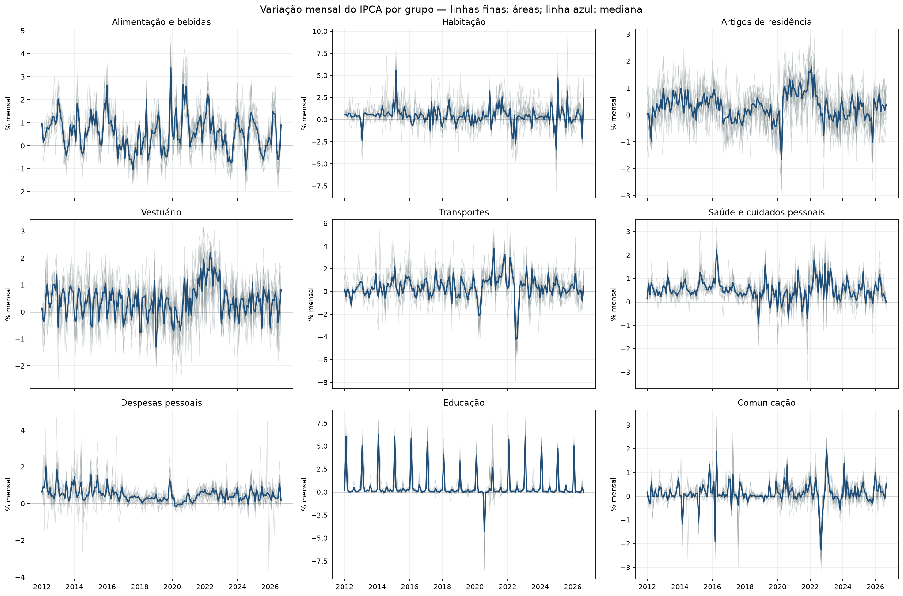
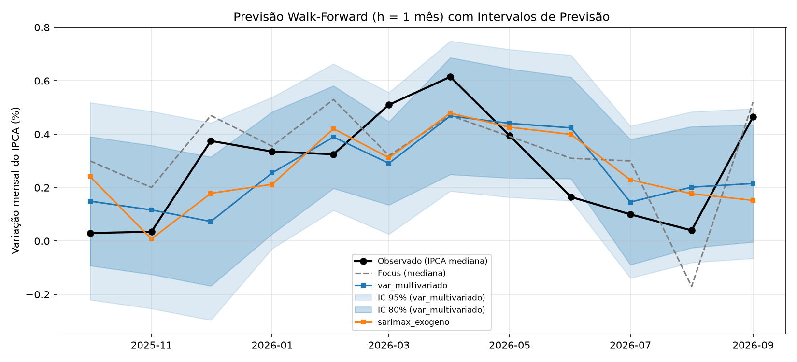

# Inflação e Comunicação do Copom
### Previsão Multivariada do IPCA Regional e Análise de Sentimento com LLM

**Disciplina:** Séries Temporais e Análise Preditiva  
**Período:** Janeiro/2012 – Setembro/2026 (177 meses)

---

## 1. Problema e Pergunta de Pesquisa

> *Qual será o IPCA mensal de cada região metropolitana e de cada grupo de despesa nos próximos 3 meses, e o tom das atas do Copom ajuda a prever a inflação?*

- **Alvo:** variação mensal do IPCA (%) por área geográfica e grupo de despesa.
- **Horizonte:** $h = 1, 2, 3$ meses (alinhado a dois ciclos de reunião do Copom).
- **Benchmark obrigatório:** mediana das expectativas **Focus** (BCB).

---

## 2. Base de Dados e Estrutura de Painel

- **IBGE/SIDRA (tabelas 1419 e 7060):** 16 áreas × 9 grupos de despesa × 177 meses = **25.488 observações**.
- **BCB/SGS:** Selic (`4189`), câmbio USD/BRL (`3697`), IC-Br (`27574`), IBC-Br dessazonalizado (`24364`), desocupação (`24369`) e IPCA Brasil (`433`).
- **BCB/Expectativas:** mediana Focus mensal (`base_calculo = 0`, sem vazamento temporal).
- **BCB/Copom:** **238** atas e comunicados oficiais desde `2012-01-18`.

---

## 3. Análise Exploratória (EDA)

- **Ausentes:** `2.487` valores nulos preservados sem imputação artificial.
- **Outliers:** `1.239` observações sinalizadas por `1,5 × IQR` (mantidas por refletirem choques reais).
- **Decomposição e estacionariedade:** STL (`period=12`), testes conjuntos ADF + KPSS e ACF/PACF nas 144 séries.

---

## 4. Correlação, Granger e VIF

| Variável | Entra | Melhor lag CCF | Granger min *p* | VIF (nível) | VIF (1ª dif.) |
| :--- | :---: | :---: | :---: | :---: | :---: |
| `selic_efetiva_aa` | Sim | 2 | **0,0370** | 2,08 | 1,06 |
| `cambio_usd_brl` | Sim | 1 | 0,1627 | 12,44 | 1,62 |
| `ic_br` | Sim | 11 | 0,0595 | 17,42 | 1,46 |
| `ibc_br_sa` | Sim | 4 | 0,1245 | 7,69 | 1,15 |
| `desocupacao` | Sim | 4 | 0,5577 | 6,55 | 1,06 |

- Colinearidade em nível eliminada em **primeira diferença** (VIF ≤ 1,62).
- Lags selecionados: `1, 3, 6, 12` (e primeiras diferenças no VAR).

---

## 5. Modelagem e Validação Walk-Forward ($h = 1, 2, 3$)

- **4 famílias + Focus:** Naïve Sazonal, Focus Mediana, Estatísticos (VAR, SARIMAX, Ridge), Aprendizado de Máquina (Random Forest com janelas móveis) e Rede Neural (LSTM PyTorch).
- **Validação:** origem móvel nos últimos 12 meses (`2025-10` a `2026-09`), sem embaralhamento.

| Modelo | MAE | RMSE | sMAPE (%) | MASE |
| :--- | :---: | :---: | :---: | :---: |
| `focus_mediana` | **0,1351** | **0,1526** | 58,45 | **0,7168** |
| `baseline_naive_sazonal` | 0,1391 | 0,1837 | **53,62** | 0,7382 |
| `var_multivariado` | 0,1734 | 0,1914 | 73,34 | 0,9202 |
| `sarimax_exogeno` | 0,1731 | 0,1918 | 72,46 | 0,9188 |
| `regressao_ridge` | 0,1737 | 0,2042 | 73,21 | 0,9220 |
| `random_forest` | 0,1798 | 0,2062 | 70,80 | 0,9544 |
| `lstm_multivariado` | 0,1965 | 0,2751 | 93,39 | 1,0427 |

---

## 6. Intervalos de Previsão e Diebold-Mariano

- **Diebold-Mariano:** sem diferença significativa entre `var_multivariado` e `sarimax_exogeno` ($p > 0,89$ em $h=1,2,3$).
- **Destaque em $h = 1$ mês:** `var_multivariado` (RMSE = `0,1711`) supera o naïve sazonal (`0,2007`) e aproxima-se do Focus (`0,1625`).

---

## 7. Previsão no Painel Completo (`16 áreas × 9 grupos`)

Modelos globais de painel superam o baseline naïve sazonal nos três horizontes:

| Modelo | Horizonte | N | MAE | RMSE | MASE |
| :--- | :---: | :---: | :---: | :---: | :---: |
| `ridge_painel` | 1 mês | 1.728 | **0,5956** | **0,9070** | **0,7157** |
| `random_forest_painel` | 1 mês | 1.728 | 0,6071 | 0,9095 | 0,7296 |
| `baseline_naive_sazonal_painel` | 1 mês | 1.728 | 0,6713 | 1,0602 | 0,8067 |
| `ridge_painel` | 2 meses | 1.584 | **0,6037** | **0,9316** | **0,7005** |
| `ridge_painel` | 3 meses | 1.440 | **0,6001** | **0,9445** | **0,7053** |

---

## 8. Sentimento do Copom com LLM (Etapa 6)

- **Classificação LLM (`rotulo_llm.json`):** 200 documentos distintos (`76` neutros, `76` contracionistas, `48` expansionistas), **kappa = `0,3803`** vs. léxico de referência.
- **Impacto no SARIMAX walk-forward ($h = 1$ mês, 12 meses de teste):**

| Modelo | MAE | RMSE | sMAPE (%) | MASE |
| :--- | :---: | :---: | :---: | :---: |
| `sarimax_sem_sentimento` | **0,1329** | **0,1668** | **63,08** | **0,8674** |
| `sarimax_com_sentimento` | 0,1430 | 0,1771 | 70,17 | 0,9335 |

O tom defasado em 1 mês não melhorou o SARIMAX em $h=1$, indicando defasagem maior de transmissão ou incorporação prévia nas variáveis macro.

---

## 9. Limitações e Próximos Passos

- **Rotulagem humana:** preencher os 200 rótulos em `rotulacao_manual.csv` para medir o kappa `manual_vs_llm`.
- **Cobertura textual:** expandir dos 200 trechos representativos para os 1.094 trechos completos e incluir notícias econômicas.
- **Métricas:** usar MASE/sMAPE em vez de MAPE devido a valores de IPCA próximos de zero.
- **Amostra de teste:** ampliar a janela fora da amostra para maior poder no teste de Diebold-Mariano.
